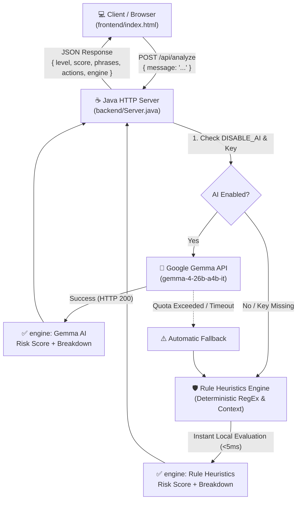

# 🛡️ ScamLens

<div align="center">


**An intelligent, dual-engine scam detection platform designed to protect students, job seekers, and everyday users from fraudulent job postings, fake internship offers, and advance-fee scams.**

[Live Demo](#-production-deployment) • [Key Features](#-key-features) • [Architecture](#-system-architecture) • [Quick Start](#-quick-start-local-development) • [API Reference](#-api-reference) • [Test Suite](#-automated-testing-suite)

</div>

---

## 📌 Overview & Problem Statement

College students and early-career professionals are increasingly targeted by sophisticated recruitment scams. Malicious actors masquerade as reputable tech firms or university programs, sending convincing invitation emails that later demand:
- **"Refundable" onboarding or equipment security deposits** (often requested via UPI, wire transfer, or cryptocurrency).
- **Extreme psychological pressure and artificial urgency** (*"Pay within 30 minutes to confirm your seat"*).
- **Phishing links** leading to credential-harvesting portals.

**ScamLens** solves this by providing immediate, contextual threat analysis. It dissects incoming messages using a **hybrid intelligence model**: deep contextual reasoning powered by **Google Gemma AI**, backed by a resilient, deterministic **Rule Heuristics Engine** with zero external dependencies.

---

## ✨ Key Features

- 🧠 **Dual-Engine Hybrid Intelligence:**
  - **Primary:** Google Gemma LLM (`gemma-4-26b-a4b-it`) for nuanced semantic risk evaluation and actionable safety advice.
  - **Secondary:** High-speed, local deterministic Rule Heuristics engine providing instant fallback when API quotas are exceeded, connection times out, or when running offline.
- 🎯 **Context-Aware Payment Negation:**
  - Avoids false alarms on legitimate communications that state *"no application fee"*, *"never ask you to pay"*, or *"fees are 100% waived"*.
  - Accurately detects deceptive messages that claim *"no application fee"* but subsequently slip in a *"refundable security deposit of ₹799"*.
- ⏱️ **Temporal Urgency Dissection:**
  - Distinguishes high-pressure coercive tactics (*"within 30 minutes"*, *"avoid losing your seat"*, *"act now"*) from benign recruitment deadlines (*"reply within 3 days"*, *"deadline next Friday"*).
- 🔒 **Zero-Trust Security & Secrets Isolation:**
  - Gemma API keys remain exclusively on the backend server; never exposed to browser clients, Git commits, or response bodies.
  - Request authentication uses secure `x-goog-api-key` headers instead of leaky URL query parameters.
  - Sanitized logging guarantees credentials and sensitive payloads are never printed.
- ⚡ **Ultra-Lightweight & Zero-Bloat Backend:**
  - Built with native Java Standard Edition (`com.sun.net.httpserver`, `java.net.http`).
  - No Spring, no third-party JARs, and no framework overhead. Sub-100ms cold starts with minimal memory footprint.
- 🌐 **Production-Ready & Configurable:**
  - Environment-driven `PORT` configuration for seamless cloud hosting (Render, Railway, Fly.io).
  - Safe, origin-aware CORS protection (`ALLOWED_ORIGINS` whitelist) with local development compatibility.
  - Fully Dockerized multi-stage container build.

---

## 🏗️ System Architecture



---

## 📁 Project Structure

```text
scamlens/
├── backend/
│   ├── Server.java            # Native Java HTTP REST Server & Heuristics Engine
│   └── ServerTest.java        # Comprehensive automated test suite (6 test cases)
├── frontend/
│   ├── index.html             # Responsive UI with score gauge & findings breakdown
│   ├── style.css              # Custom design system (dark mode, glassmorphism)
│   └── app.js                 # Frontend state, API client, & dynamic origin resolution
├── .dockerignore              # Excludes secrets, git history, and build artifacts
├── .gitignore                 # Enforces zero secret commits (.env, *.class)
├── Dockerfile                 # Multi-stage container build for Render deployment
└── README.md                  # Complete platform documentation
```

---

## ⚙️ Configuration & Environment Variables

Configure these variables in your environment or hosting dashboard:

| Variable | Default | Required | Description |
| :--- | :--- | :---: | :--- |
| `PORT` | `8080` | No | Server port. Automatically supplied by Render in production. |
| `GEMMA_API_KEY` | *(None)* | No | Google AI Studio API key. Kept exclusively on backend. If omitted, server runs in Rule Heuristics mode. |
| `GEMMA_MODEL` | `gemma-4-26b-a4b-it` | No | Model identifier used for Google AI calls. |
| `ALLOWED_ORIGINS` | *(Local only)* | No | Comma-separated whitelist of allowed CORS origins (e.g., `https://praneethperumalla027-hue.github.io`). |
| `DISABLE_AI` | `false` | No | When set to `true`, disables external AI calls and forces deterministic Rule Heuristics mode (ideal for local testing). |

---

## 🚀 Quick Start (Local Development)

### Prerequisites
- **Java SE Development Kit (JDK 17 or higher)**
- **Modern Web Browser** (Chrome, Edge, Firefox, Safari)

### 1. Clone the Repository
```bash
git clone https://github.com/praneethperumalla027-hue/scamlens.git
cd scamlens
```

### 2. Configure Environment (Optional)
To use Gemma AI, create a `.env` file in the project root (this file is automatically ignored by `.gitignore`):
```env
GEMMA_API_KEY=your_google_ai_studio_api_key_here
```
> *Tip: If you do not have an API key, ScamLens runs seamlessly out-of-the-box using the local Rule Heuristics engine.*

### 3. Compile and Start the Backend
```bash
# Compile
javac -encoding UTF-8 -cp backend backend/Server.java

# Run
java -cp backend Server
```
*The server will start at `http://localhost:8080`.*

### 4. Open the Frontend
Simply open `frontend/index.html` in your browser:
```bash
# Windows
start frontend/index.html

# macOS
open frontend/index.html

# Linux
xdg-open frontend/index.html
```

---

## 🧪 Automated Testing Suite

ScamLens includes a comprehensive, standalone test suite (`backend/ServerTest.java`) that verifies accuracy, payment negation handling, and urgency detection without calling external APIs.

### Run the Tests
```bash
javac -encoding UTF-8 -cp backend backend/Server.java backend/ServerTest.java
java -cp backend ServerTest
```

### Test Coverage Summary:
| # | Scenario | Input Characteristics | Expected Level | Expected Outcome |
| :-: | :--- | :--- | :-: | :--- |
| **1** | **Legitimate Internship** | *"There is no application or registration fee"* | **Low** (< 35) | Zero false alarms; no payment flags. |
| **2** | **Explicit Registration Scam** | *"Pay refundable fee of $30 via UPI within 2h"* | **High** (≥ 60) | Flags upfront payment and urgency pressure. |
| **3** | **Phishing with No-Fee Clause** | *"No fee... click link immediately to verify"* | **Medium** | Flags suspicious URL and urgency; does **not** falsely flag payment. |
| **4** | **Deceptive Mixed Scam** | *"No application fee... pay deposit of ₹799 in 30m"* | **High** (≥ 60) | Flags **both** upfront deposit and 30-min coercive urgency. |
| **5** | **Benign Scheduling Window** | *"Select interview slot within 3 days"* | **Low** (≤ 15) | Ordinary 3-day scheduling window is **not** flagged as urgency. |
| **6** | **Fee Waiver Exemption** | *"Registration fee has been 100% waived"* | **Low** (≤ 10) | Fee waiver accurately recognized; zero false positives. |

---

## 📡 API Reference

### 1. Health Check
`GET /api/health`

**Response (`200 OK`):**
```json
{
  "status": "ok",
  "service": "ScamLens Java Backend",
  "version": "1.1.0",
  "aiConfigured": true,
  "model": "gemma-4-26b-a4b-it"
}
```

---

### 2. Analyze Message
`POST /api/analyze`

**Request Body (`application/json`):**
```json
{
  "message": "Congratulations! There is no application fee. However, you must pay a refundable security deposit of ₹799 within 30 minutes to secure your seat."
}
```

**Response Body (`200 OK`):**
```json
{
  "level": "high",
  "label": "High Risk — Probable Scam",
  "summary": "Critical scam indicators detected. Immediate caution advised.",
  "explanation": "Warning signs identified: Requests upfront money, deposit, or fees (often disguised as refundable onboarding charges), which is characteristic of advance-fee scams. Uses high urgency or pressure tactics to rush your decision before you have time to verify.",
  "phrases": [
    "Request for upfront payment, deposit, or fee",
    "High urgency / psychological pressure"
  ],
  "actions": [
    "Do not send money, gift cards, or cryptocurrency under any circumstances.",
    "Verify the opportunity directly on the organization's official careers portal.",
    "Never share one-time passwords (OTPs), bank account PINs, or sensitive documents."
  ],
  "score": 80,
  "engine": "Rule Heuristics"
}
```

---

## 🚢 Production Deployment

### Backend on [Render](https://render.com/) (Docker Web Service)

1. Create a new **Web Service** on Render and connect your GitHub repository `praneethperumalla027-hue/scamlens`.
2. Choose **Docker** as the environment. Render automatically detects the root `Dockerfile`.
3. Under **Environment Variables**, configure:
   - `GEMMA_API_KEY`: *(Optional)* Your Google AI API key.
   - `ALLOWED_ORIGINS`: Your frontend domain (e.g., `https://praneethperumalla027-hue.github.io`).
   - *(Render automatically assigns and binds `PORT`)*.
4. Click **Deploy**. Your API will be live at `https://<service-name>.onrender.com`.

### Frontend on GitHub Pages

1. Navigate to your repository settings on GitHub: **Settings > Pages**.
2. Select `master` branch and set the folder to `/frontend`.
3. To connect the frontend to your deployed Render backend, either:
   - Set the backend URL in browser `localStorage`:
     ```javascript
     localStorage.setItem('scamlens_api_url', 'https://your-backend.onrender.com');
     ```
   - Or configure `window.SCAMLENS_API_URL = "https://your-backend.onrender.com"` in `frontend/app.js`.

---

## 🔐 Security & Privacy Posture

- **No Secret Leakage:** Backend logs automatically redact sensitive credentials. The API key is stored only in environment variables and never exposed to clients.
- **Header-Based Authentication:** Outgoing AI requests transmit keys via standard `x-goog-api-key` headers rather than query strings.
- **CORS Restriction:** Strict origin matching prevents unauthorized third-party domains from leveraging your analysis endpoints in production.
- **Data Privacy:** User messages analyzed locally via Rule Heuristics never leave the server.

---

## 📄 License

This project is licensed under the [MIT License](LICENSE). Contributions and improvements are welcome!
