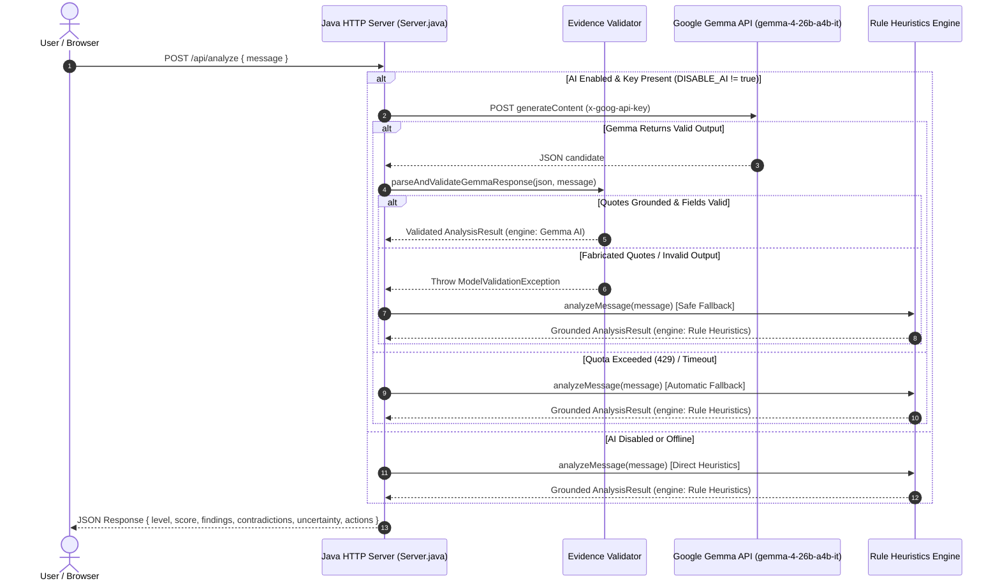

# 🛡️ ScamLens — “Explain Before You Trust”

<div align="center">


**A grounded AI & deterministic heuristic security platform designed to inspect job, internship, scholarship, and payment messages, explain evidence, distinguish facts from uncertainty, and recommend safe verification steps.**

[Live Demo](#-production-deployment) • [Why Not a Wrapper?](#-more-than-a-basic-llm-wrapper) • [Architecture](#-system-architecture--data-flow) • [Threat Model](#-threat-model--scope) • [API Reference](#-api-reference) • [Test Suite](#-automated-testing-suite)

</div>

---

## 📌 Philosophy: “Explain Before You Trust”

Most automated security tools either act as opaque black boxes that output a generic risk score without explanation, or blindly pipe messages into a cloud LLM with zero grounding or validation.

**ScamLens** was engineered around a core principle: **Explain Before You Trust**. It decomposes incoming messages into:
1. **Directly Observed Text:** Verifiable, verbatim quotes from the submitted message.
2. **Analytical Inferences:** Grounded explanations of why specific patterns represent social engineering or advance-fee tactics.
3. **Deceptive Contradictions:** Explicit detection of conflicting statements (e.g., claiming *"no application fee"* while demanding a *"refundable security deposit"*).
4. **Analytical Uncertainty:** Honest, calibrated disclosures regarding false-positive risks and textual limitations.
5. **Actionable Defense:** Step-by-step verification guidelines that don't depend on trusting the sender.

---

## 💡 What Makes ScamLens More Than a Basic LLM Wrapper?

Many hackathon AI projects are simple API wrappers that send user text to an LLM and pass the string back to the client. ScamLens introduces a production-grade security architecture:

| Challenge | Basic LLM Wrapper | ScamLens Security Architecture |
| :--- | :--- | :--- |
| **Model Hallucination** | Blindly accepts invented facts or fake quotes generated by the LLM. | **Server-Side Quote Grounding:** The Java backend cross-checks every quote returned by the model against the original input. Fabricated quotes are rejected and never presented to the user. |
| **Quota Exhaustion & Outages** | Fails completely with HTTP 429 / 500 when API limits are reached. | **Deterministic Rule Fallback:** Automatically switches to a local Java heuristic analyzer that executes in < 5ms with zero network calls. |
| **Deceptive Contradictions** | Can be misled by prompts stating *"No fee required"* and lower the score. | **Contradiction-Aware Engine:** Explicitly recognizes when an initial fee denial is followed by a hidden deposit demand and flags the contradiction. |
| **False Alarms on Deadlines** | Flags legitimate deadlines (*"by Friday"*, *"within 3 days"*) as scam urgency. | **Temporal Urgency Dissection:** Distinguishes coercive short countdowns (*"within 30 minutes"*, *"avoid losing your seat"*) from standard interview timelines. |
| **Dependency Bloat & Vulnerabilities** | Pulls in heavy frameworks (Spring, LangChain, large node packages). | **Zero External Dependencies:** Built with pure Java SE (`com.sun.net.httpserver`, `java.net.http`). Fast cold start (< 100ms) and minimal attack surface. |
| **Transparency & Truth in Labeling** | Labels all output as "AI-Powered", even during static fallback. | **Honest Engine Attribution:** Accurately labels output as `Gemma AI (model)` or `Rule Heuristics`. Never claims fallback used AI. |

---

## 🏗️ System Architecture & Data Flow



---

## 🎯 Threat Model & Scope

ScamLens is engineered specifically to address common threat vectors targeting students and job applicants:

### In-Scope Threat Indicators:
- **Advance-Fee Recruitment Fraud:** Demanding upfront deposits, onboarding insurance, laptop reservations, or background check fees under the guise of "refundable" deposits.
- **Deceptive Fee Contradictions:** Claiming an opportunity is "100% free" in one sentence before introducing mandatory payments later in the communication.
- **Coercive Urgency & Ultimatums:** Extreme artificial deadlines designed to prevent victim verification (*"within 30 minutes"*, *"avoid losing your slot"*).
- **Phishing & Credential Theft:** Suspicious top-level domains (`.xyz`, `.top`), IP-based URLs, and redirection links designed to steal university credentials or banking details.
- **Unrealistic Compensation / No-Interview Selection:** Offering extraordinary compensation ($45/hr data entry) or hiring without an interview process.

### Explicit Limitations & Out-of-Scope:
- **Textual Evidence Only:** ScamLens evaluates message text. It does not perform live domain WHOIS queries or external business registry checks.
- **Offline / Out-of-Band Verification:** It cannot verify caller IDs, spoofed phone numbers, or offline business licenses.
- **Risk Assessment, Not Absolute Proof:** Results represent heuristic and semantic threat assessments, not definitive proof of criminality or calibrated mathematical probabilities.

---

## 📁 Project Structure

```text
scamlens/
├── backend/
│   ├── Server.java            # Native Java HTTP Server, Gemma Client, Validator & Heuristics
│   └── ServerTest.java        # Standalone test suite (12 technical test cases)
├── frontend/
│   ├── index.html             # Judge-ready interface with demo selector & findings cards
│   ├── style.css              # Custom responsive design system (Plus Jakarta Sans, Mono)
│   └── app.js                 # Frontend client, evidence renderer, & dynamic URL resolver
├── .dockerignore              # Prevents secrets, Git history, and class files in container
├── .gitignore                 # Enforces zero secret commits (.env, *.class)
├── Dockerfile                 # Multi-stage Eclipse Temurin Java container for Render
├── LICENSE                    # MIT License
└── README.md                  # System documentation
```

---

## ⚙️ Configuration & Environment Variables

| Variable | Default | Description |
| :--- | :--- | :--- |
| `PORT` | `8080` | Port for the Java HTTP server to listen on (Render supplies this automatically). |
| `GEMMA_API_KEY` | *(None)* | Google AI Studio API key. Kept exclusively on backend. Never required for local rule analysis. |
| `GEMMA_MODEL` | `gemma-4-26b-a4b-it` | Target Google Gemma model identifier. |
| `ALLOWED_ORIGINS` | *(Local dev)* | Comma-separated CORS whitelist (e.g., `https://praneethperumalla027-hue.github.io`). |
| `DISABLE_AI` | `false` | When set to `true`, forces instant local Rule Heuristics mode (useful when offline or quota is exhausted). |

---

## 🚀 Quick Start (Local Development)

### Prerequisites
- **Java SE Development Kit (JDK 17 or higher)**
- **Modern Web Browser** (Chrome, Firefox, Edge, Safari)

### 1. Compile Backend
```bash
javac -encoding UTF-8 -cp backend backend/Server.java
```

### 2. Start the Backend Server
```bash
java -cp backend Server
```
*The server will start at `http://localhost:8080`.*

### 3. Open the Frontend
Open `frontend/index.html` in your browser:
```bash
# Windows
start frontend/index.html

# macOS
open frontend/index.html
```

---

## 🧪 Automated Testing Suite

ScamLens includes a comprehensive, standalone test suite (`backend/ServerTest.java`) that verifies accuracy, server-side evidence validation, hallucination rejection, and contradiction handling **without making paid or external network calls**.

### Run the Tests
```bash
javac -encoding UTF-8 -cp backend backend/Server.java backend/ServerTest.java
java -cp backend ServerTest
```

### Technical Test Coverage (21 / 21 Tests):
| # | Test Scenario | Verified Behavior |
| :-: | :--- | :--- |
| **1** | **Legitimate Internship (No Fee)** | Verified classified as **Low Risk** (< 35/100) with 0 false alarms. |
| **2** | **Explicit Registration Scam** | Verified classified as **High Risk** (≥ 60/100) and detects upfront payment. |
| **3** | **No-Fee Clause with Phishing Link** | Flags urgency and suspicious URL; does **not** falsely flag payment demand. |
| **4** | **Mixed Fee Negation + Urgent Deposit** | Detects deceptive contradiction, flags deposit quote, and catches 30-min urgency. |
| **5** | **Benign Scheduling Window** | Standard 3-day interview window is **not** misclassified as scam urgency. |
| **6** | **Fee Waiver Exemption** | 100% fee waiver is recognized; zero false alarms for payment or urgency. |
| **7** | **Authentic Quote Validation** | Server verifies and grounds quotes that exist verbatim in the submitted message text. |
| **8** | **Fabricated Quote Rejection** | Server catches and rejects hallucinated quotes not present in the user message. |
| **9** | **Strict Risk Level Enforcement** | Rejects uncalibrated/invalid risk levels (`"catastrophic"`, `""`) via `ModelValidationException`. |
| **10** | **Malformed AI Output Handling** | Corrupted or non-JSON model output triggers safe, deterministic heuristic fallback. |
| **11** | **Structured Findings & Contradictions** | Validates structured `findings` array, `contradictions` list, and `uncertainty` notes. |
| **12** | **Suspicious Phishing Domains** | Identifies `.xyz`, shortened links, and raw IP address link formats. |
| **13** | **Multi-Part Gemma Reasoning Extraction** | Separates `thought: true` reasoning parts from the final JSON answer. |
| **14** | **Markdown Code Fence Stripping** | Strips ```` ```json ```` fences and extracts clean JSON object. |
| **15** | **Harmless Commentary Bypass** | Extracts valid JSON object embedded within natural language commentary. |
| **16** | **Unbalanced Curly Braces Rejection** | Rejects malformed JSON containing unbalanced brackets via `ModelValidationException`. |
| **17** | **Ambiguous Multiple Root Objects** | Rejects ambiguous outputs containing conflicting root JSON blocks. |
| **18** | **Out-of-Range Risk Score Enforcement** | Strictly enforces that `score` must be an integer between 0 and 100. |
| **19** | **Missing Required Field Rejection** | Rejects model output missing required schema fields (`explanation`, `summary`, etc.). |
| **20** | **Array Parsing with Embedded Brackets** | Robust quote-aware parsing of string arrays containing brackets (`[url]`, `[30 min]`). |
| **21** | **AI Network Failure & Rule Fallback** | Verifies deterministic fallback to `Rule Heuristics` upon simulated AI failure. |

---

## 📡 API Reference

### `GET /api/health`
Checks server status and configuration.

**Response (`200 OK`):**
```json
{
  "status": "ok",
  "service": "ScamLens Java Backend",
  "version": "1.1.0",
  "aiConfigured": true,
  "model": "gemma-4-26b-a4b-it"
}
```

---

### `POST /api/analyze`
Submits a message for grounded evidence analysis.

**Request (`application/json`):**
```json
{
  "message": "Congratulations! There is no application fee for this role. However, you must pay a refundable security deposit of ₹799 within 30 minutes to secure your seat."
}
```

**Response (`200 OK`):**
```json
{
  "level": "high",
  "label": "High Risk",
  "summary": "Multiple severe scam indicators detected in this message.",
  "explanation": "Warning signs identified: Deceptively claims no application fee while simultaneously demanding an upfront deposit or fee. Requests upfront money, deposit, or fees...",
  "engine": "Rule Heuristics",
  "score": 95,
  "phrases": [
    "Contradictory fee statement (Fee denial combined with payment demand)",
    "Request for upfront payment, deposit, or fee",
    "High urgency / psychological pressure"
  ],
  "actions": [
    "Do NOT send money, UPI transfers, cryptocurrency, or gift cards under any circumstances.",
    "Do not rush. Legitimate employers allow reasonable time to evaluate opportunities.",
    "Verify the opportunity directly on the organization's official careers portal."
  ],
  "findings": [
    {
      "category": "Contradictory Fee Statements",
      "quote": "There is no application fee for this role ... However, you must pay a refundable security deposit of ₹799 within 30 minutes to secure your seat",
      "explanation": "The message states that no application fee is required, yet subsequently requests a deposit or payment. Scammers frequently use initial 'no fee' assurances to lower guard before introducing mandatory fees.",
      "action": "Disregard initial assurances of 'no fee' when payment is requested elsewhere. Legitimate employers never require onboarding or security deposits.",
      "isGrounded": true
    },
    {
      "category": "Upfront Payment / Deposit Demand",
      "quote": "However, you must pay a refundable security deposit of ₹799 within 30 minutes to secure your seat",
      "explanation": "Requests upfront money, deposit, or fees (often disguised as refundable onboarding charges), which is characteristic of advance-fee scams.",
      "action": "Do NOT send money, UPI transfers, cryptocurrency, or gift cards under any circumstances.",
      "isGrounded": true
    },
    {
      "category": "High Urgency / Pressure Tactics",
      "quote": "within 30 minutes",
      "explanation": "Uses artificial time pressure or ultimatums to rush your decision before you have time to independently verify the opportunity.",
      "action": "Do not rush. Take time to verify the sender through independent channels.",
      "isGrounded": true
    }
  ],
  "contradictions": [
    "Message contains conflicting statements: denies fees ('There is no application fee for this role') but subsequently demands payment ('However, you must pay a refundable security deposit of ₹799 within 30 minutes to secure your seat')."
  ],
  "uncertainty": "High-confidence risk indicators identified. While automated text analysis cannot establish legal proof of fraud, the detected combination of demands strongly aligns with known advance-fee and phishing scam patterns."
}
```

---

## 🚢 Production Deployment

### Backend on [Render](https://render.com/) (Docker Web Service)

1. Create a new **Web Service** on Render and select your GitHub repository.
2. Select **Docker** as the environment (uses the root `Dockerfile`).
3. Set environment variables in the Render dashboard:
   - `GEMMA_API_KEY`: Your Google AI Studio API key.
   - `ALLOWED_ORIGINS`: Your frontend domain (e.g. `https://praneethperumalla027-hue.github.io`).
4. Render automatically manages builds, TLS certificates, and port binding.

### Frontend on GitHub Pages

1. Navigate to repository **Settings > Pages**.
2. Select `master` branch and directory `/frontend`.
3. To configure the backend URL:
   - Set in browser storage: `localStorage.setItem('scamlens_api_url', 'https://your-service.onrender.com');`
   - Or set `window.SCAMLENS_API_URL = "https://your-service.onrender.com"` in `frontend/app.js`.

---

## 📄 License

This project is licensed under the [MIT License](LICENSE).
